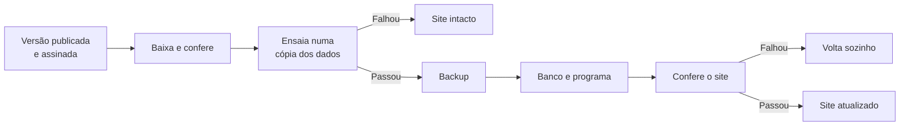

<div align="center">


# MyMonetto

<sub>Antes chamado Financeiro. Os comandos e as pastas continuam com o nome antigo.</sub>

**Controle o dinheiro da sua casa no seu próprio computador: lance gastos em segundos, veja como o mês vai fechar e planeje compras, dívidas e investimentos.**

Sem assinatura, sem nuvem e sem pedir a senha do seu banco.

[](CHANGELOG.md)   

[Diferenciais](#diferenciais) · [Telas](#telas) · [Como funciona](#como-funciona) · [Instalar](#instalar) · [Atualizar](#atualizar-e-guardar) · [Documentação](#documentação) · [English](README.en.md)

<br>

<picture>
  <source media="(prefers-color-scheme: dark)" srcset="docs/img/pc-inicio-escuro.webp">
  
</picture>

<sub>Todos os prints usam dados fictícios do modo de demonstração.</sub>

</div>

## Diferenciais

### Veja o futuro da sua conta

Mês a mês, veja quanto terá na conta e teste "e se" sem salvar nada.

<picture>
  <source media="(prefers-color-scheme: dark)" srcset="docs/img/pc-futuro-escuro.webp">
  
</picture>

### Saiba o melhor mês para comprar

Cole o link do que quer comprar, em qualquer moeda, e o app indica quando a compra cabe no seu plano.

<picture>
  <source media="(prefers-color-scheme: dark)" srcset="docs/img/pc-wishlist-escuro.webp">
  
</picture>

### Descubra se vale adiantar o empréstimo

Digite um valor e veja quanto falta, quando termina e quanto de juros você deixa de pagar.

<picture>
  <source media="(prefers-color-scheme: dark)" srcset="docs/img/pc-emprestimo-escuro.webp">
  
</picture>

### Saiba quanto vem nas próximas faturas

Lance compras parceladas e veja o valor de cada fatura antes de ela chegar.

<picture>
  <source media="(prefers-color-scheme: dark)" srcset="docs/img/pc-cartao-escuro.webp">
  
</picture>

### Receba um relatório que explica seu mês

Baixe em PDF, por mês ou por ano, com gráficos, o que foi bom, o que foi ruim e o que pode melhorar.

<picture>
  <source media="(prefers-color-scheme: dark)" srcset="docs/img/pc-relatorio-escuro.webp">
  
</picture>

### Escolha a cara do seu app

São 8 paletas com prévia, cada uma em claro, escuro ou automático, incluindo alto contraste e daltonismo.

<picture>
  <source media="(prefers-color-scheme: dark)" srcset="docs/img/pc-temas-escuro.webp">
  
</picture>

## Telas

Funciona no computador e no celular.

<picture>
  <source media="(prefers-color-scheme: dark)" srcset="docs/img/pc-mes-escuro.webp">
  
</picture>

<table>
  <tr>
    <td align="center"><br><b>Início</b></td>
    <td align="center"><br><b>Lançar</b></td>
    <td align="center"><br><b>Mês</b></td>
  </tr>
</table>

## Como funciona

1. **Comece.** Crie a sua conta e informe a data de início e quanto você tem hoje.
2. **Lance.** Aperte **Lançar**, digite o valor e escolha a categoria.
3. **Acompanhe.** Abra **Mês** para ver como ele deve terminar.
4. **Feche.** No fim do mês, confira o saldo com o banco e feche o mês.

## Instalar

No Windows, no Mac e no Linux, não há banco de dados nem outro programa para instalar.

### Windows

Windows 10 ou 11, de 64 bits. Não pede administrador.

1. Baixe `financeiro-…-windows-x86_64.exe` em [Versões](https://github.com/HunterBDZ/MyMonetto/releases/latest).
2. Dê dois cliques no arquivo.
3. Se aparecer **"O Windows protegeu o computador"**, clique em **Mais informações** e depois em **Executar assim mesmo**.
4. No fim, deixe marcado **Abrir o MyMonetto** e crie a sua conta no navegador.

Depois, abra pelo ícone **Financeiro** na área de trabalho. Ele liga sozinho quando você entra no Windows.

### Mac

Mac com chip Apple e macOS 12 ou mais novo. Mac Intel ainda não é atendido.

1. Baixe `financeiro-…-macos-arm64.dmg` em [Versões](https://github.com/HunterBDZ/MyMonetto/releases/latest) e abra o arquivo.
2. Arraste o **Financeiro** para **Aplicativos** e abra de lá.
3. Se o Mac disser que não pode verificar o app, abra **Ajustes do Sistema → Privacidade e Segurança** e clique em **Abrir Mesmo Assim**.
4. Crie a sua conta no navegador.

Depois, abra pelo Financeiro em Aplicativos. Ele liga sozinho quando você entra no Mac.

> [!WARNING]
> Os instaladores de Windows e Mac são novos: o de Windows já foi instalado num computador de verdade, e o de Mac ainda não passou por nenhum Mac. Os avisos do passo 3 aparecem porque eles ainda não têm assinatura paga, e não porque foi encontrado algum problema.

### Linux

Baixe o pacote em [Versões](https://github.com/HunterBDZ/MyMonetto/releases/latest) e rode, sem `sudo`:

```sh
tar xzf financeiro-*-linux-*.tar.gz
cd financeiro-*/
./instalar
```

Abra `http://localhost:8484` e crie a sua conta.

### Servidor com Ubuntu ou Debian

```sh
git clone https://github.com/HunterBDZ/MyMonetto.git
sudo bash Financeiro/instalar.sh
```

### Docker

`docker compose up -d`, na pasta do repositório.

Para usar no celular, abra **Ajustes → Usar no celular** e leia o código com a câmera. Dúvidas? Veja o [manual de instalação](docs/INSTALACAO.md).

## Atualizar e guardar

Em **Ajustes → Backup e atualização**, você procura versão nova, atualiza, baixa uma cópia dos dados e restaura um backup, sem terminal. O app também faz uma cópia por dia.

Nada se atualiza sozinho: o dono decide quando. Antes de aplicar, o app confere a assinatura da versão e a testa numa cópia dos dados. Se algo falhar, ele volta sozinho.



Em servidor, o mesmo caminho roda com `sudo financeiro-atualizar`. As mudanças de cada versão ficam no [`CHANGELOG.md`](CHANGELOG.md).

## Documentação

- **[Manual de instalação](docs/INSTALACAO.md):** instalar, atualizar, restaurar e resolver problemas.
- **[Por dentro](docs/POR-DENTRO.md):** arquitetura, pastas, testes e acessibilidade.
- **[Segurança](docs/SEGURANCA.md):** como o app protege contas e dados.
- **[Privacidade e aviso](docs/PRIVACIDADE.md):** o que sai do computador, os cookies e a licença.
- **[Como lançar uma versão](docs/LANCAR-VERSAO.md):** para quem desenvolve.
- **[Decisões](docs/decisoes.md):** o porquê de cada regra.
- **[Como contribuir](CONTRIBUTING.md)** e **[como relatar uma falha](SECURITY.md).**

## Status e licença

**Status:** em desenvolvimento ativo. As mudanças de cada versão estão no [`CHANGELOG.md`](CHANGELOG.md).

**Licença:** © 2026 Hunter. Distribuído sob a [AGPL-3.0-or-later](LICENSE).

**Componentes de terceiros:** fontes Manrope, Sora e JetBrains Mono sob a licença OFL. Veja os [avisos de terceiros](THIRD_PARTY_NOTICES.md).
